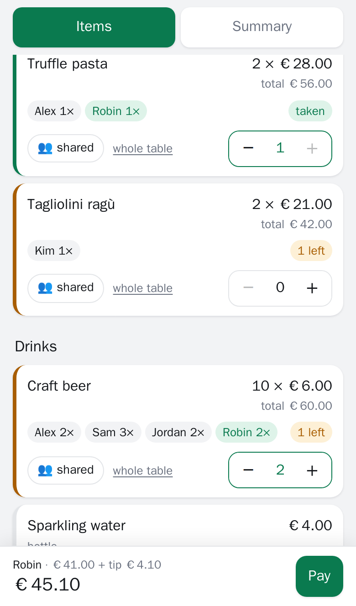
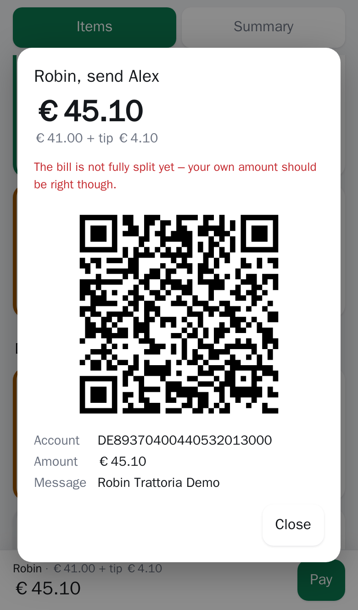
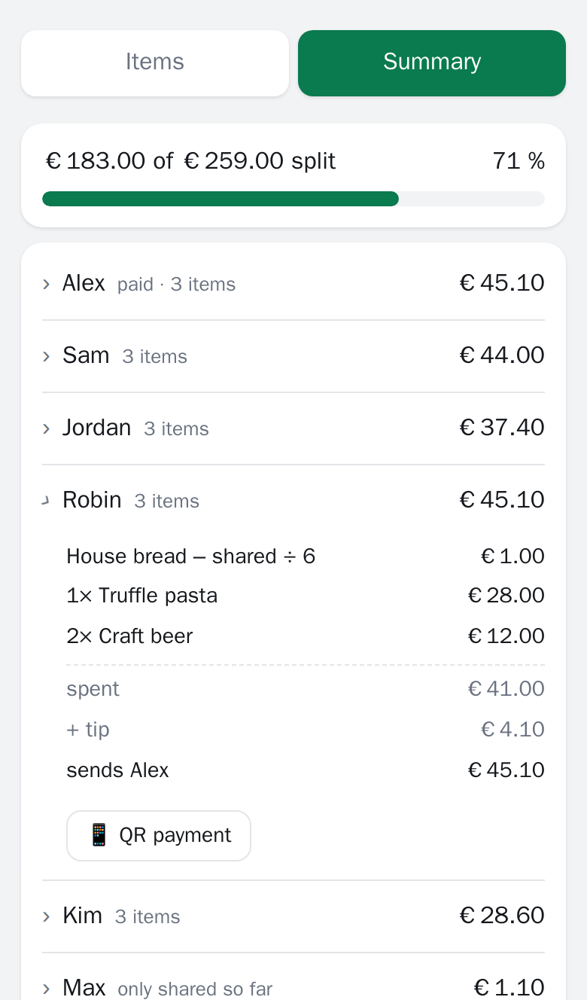

# split-the-bill 🧾

**Split a restaurant bill item by item – live, with payment QR codes. Operated by your coding agent.**

One person pays, takes a photo of the receipt and hands it to Claude Code or Codex. A minute later the whole table gets
a link: everyone taps what they had, items disappear as they are taken, and each person gets the exact amount –
tip included – plus a QR code for their banking app.

<p align="center">
  
  
  
</p>

## Why it is built this way

**The AI is not in the app – it is in the tool you deploy it with.** There is no model call, no API key and no upload
form. Reading a crumpled receipt is exactly what coding agents are good at, and they already run on a subscription the
user pays for. The repository ships the instructions ([skill](.claude/skills/new-bill/SKILL.md), [AGENTS.md](AGENTS.md));
the agent writes a JSON file and deploys.

Because an LLM can misread a `3` as an `8`, every bill goes through a **deterministic validator**: items must add up to
the printed total to the cent, the payer must be at the table, IBAN checksums must pass. The agent is told to re-read
the photo – or ask – rather than bend numbers to fit.

```
receipt photo ──► coding agent ──► bills/<slug>.json ──► npm run validate ──► deploy ──► /b/<slug>
                  (Claude Code,      (schema +            (sum = total,          (Netlify or
                   Codex …)           receipt order)       IBAN, payer …)          Vercel)
```

## Features

- **Live and race-safe.** Picks sync every few seconds. The server stamps changes and uses compare-and-set writes, so two
  people grabbing the last beer at the same time cannot both get it.
- **Shared items.** Mark an item *shared* and whatever nobody took for themselves is split among the sharers;
  *whole table* splits it among everyone.
- **Exact money.** Integer cents everywhere. The tip is distributed in proportion to consumption and shares are rounded
  with the largest-remainder method, so the amounts always add up to exactly what was paid.
- **Home currency.** Paid abroad? Add what the bank actually charged and everyone pays their share of that.
- **Payment QR codes.** SEPA/EPC QR for euro accounts, Czech *QR Platba* (SPAYD) for CZK.
- **English and Czech** UI, mobile-first, dark mode, no framework (≈ 20 kB of gzipped JS including the QR encoder).
- **Self-hosted** on your own Netlify or Vercel account, one deployment for all your bills.

## Use it with your agent

```bash
git clone https://github.com/stepanbeseda/split-the-bill && cd split-the-bill && npm install
claude            # or: codex
> Here is the receipt [photo]. There were six of us: Alex, Sam, Jordan, Robin, Kim and Max.
> I paid €284.90 including tip. My IBAN is DE89 3704 0044 0532 0130 00.
```

The agent transcribes the receipt, validates it, deploys, and replies with the link to send to the group.

Real bills contain names and bank details, so `bills/*.json` is git-ignored – deploy from your machine with the CLI and
keep the public repository free of personal data.

## Deploy

Both platforms run the same handler ([`src/server/handler.ts`](src/server/handler.ts)) behind a two-method storage
interface (`read` + compare-and-set `write`).

| | Netlify | Vercel |
|---|---|---|
| Storage | Netlify Blobs – nothing to set up | Upstash Redis from the Vercel Marketplace |
| Deploy | `npx netlify deploy --prod` | `npx vercel --prod` |
| Function | [`netlify/functions/state.mts`](netlify/functions/state.mts) | [`api/state.ts`](api/state.ts) |

Optional environment variable: `ADMIN_TOKEN` – enables the *Reset all* button for whoever knows the token.
Preview deployments use separate data, so testing never touches a live bill.

## Develop

```bash
npm run dev        # http://localhost:8888/b/demo – in-memory API, admin token "dev"
npm run check      # typecheck + unit tests + build
npm run test:e2e   # Playwright: two browsers, live sync, QR code decoding
```

| Path | What |
|---|---|
| `src/core/` | split maths, money rounding, bill validation, QR payloads – pure and unit-tested |
| `src/server/` | the API handler and storage adapters (memory, Netlify Blobs, Upstash) |
| `src/web/` | the page: plain TypeScript, `i18n.ts` holds all texts |
| `bills/` | one JSON file per bill; only `demo.json` is committed |
| `scripts/` | build, local server, `validate`, `iban` (Czech account → IBAN), `new-slug` |

## How it started

I built the first version in about 20 minutes during a flight. We had just been out for dinner, I had paid for the whole
table, and I didn't want to work out by hand who owed what. So I gave a photo of the receipt to Claude Code and asked for
a page where everyone could tap what they'd had.

It turned out to be handy enough that I cleaned it up into something reusable. If you're usually the one who pays and
then has to chase everyone for money, I hope it saves you the hassle too.

## License

[MIT](LICENSE)
